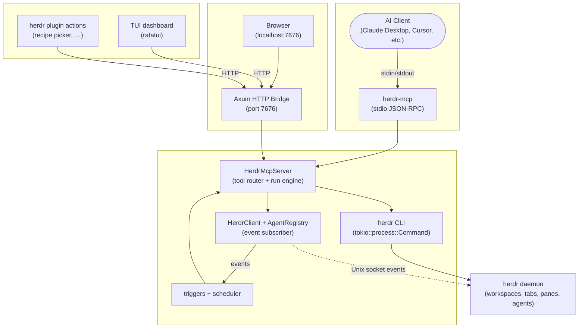

[](LICENSE)
[](https://rustup.rs/)
[](https://github.com/herdr-mcp)
[](https://github.com/herdr-mcp)
[](https://github.com/herdr-mcp)

# herdr-mcp

MCP (Model Context Protocol) server written in Rust that exposes [herdr](https://herdr.dev) — a terminal-native agent multiplexer — as tools, and extends herdr itself with recipes, triggers and a plugin.

**HTTP bridge + web playground** included: run any tool or herdr API method, chain them into recipes with variable passing, and watch herdr's live events, all from a browser.

- [Quick start](#quick-start)
- [Features](#features)
- [Architecture](#architecture)
- [Documentation](#documentation)
- [Install & build](#install--build)
- [Usage](#usage)
  - [MCP mode](#mcp-mode--http-bridge-default)
  - [herdr plugin](#herdr-plugin)
  - [HTTP API](#http-api)
  - [Recipe format](#recipe-format)
  - [Environment](#environment)
- [Tools (43)](#tools-43)
- [Development](#development)
- [Contributing](#contributing)
- [License](#license)

---

## Quick start

macOS or Linux, from the latest release (installs `herdr-mcp` in
`~/.local/bin`; `HERDR_MCP_INSTALL_DIR` picks another directory). Linux
builds are static (musl), so they run on any distro:

```bash
curl -fsSL https://raw.githubusercontent.com/eugeneb50/herdr-mcp/main/scripts/install.sh | sh
herdr-mcp
```

Or from source:

```bash
cargo build --release
./target/release/herdr-mcp
```

Requires the `herdr` CLI on `PATH` ([install](https://herdr.dev)), 0.9 or newer.

Run in a terminal, `herdr-mcp` opens the TUI dashboard over its own HTTP
bridge on `127.0.0.1:7676` — open http://localhost:7676/ for the web
playground. Launched by an MCP client (stdin not a terminal) it serves MCP over
stdio plus the bridge instead; `--no-tui` does the same from a terminal. The
web UI is built into the `herdr-mcp` binary, so the binary alone is the whole
deployment (see [Install & build](#install--build)).

### Other entry points

```bash
herdr-mcp --no-tui       # MCP stdio + HTTP, no TUI
herdr-mcp --http-only    # the HTTP bridge alone
herdr plugin install eugeneb50/herdr-mcp   # herdr-mcp as a herdr plugin
```

---

## Features

- **MCP mode** — plug into any MCP client (Claude Desktop, Cursor, Claude Code, Continue, OpenCode) to control herdr workspaces, tabs, panes and agents
- **43 tools** — discovery, lifecycle, read, write, synchronize, a2a primitives, session variables, recipes and runs, recipe templates, scheduler and clipboard; `herdr_api` reaches every method the installed herdr exposes
- **herdr plugin** — `herdr plugin install eugeneb50/herdr-mcp` adds herdr actions: a recipe picker popup that runs with the focused pane/selection as `{{herdr.…}}`, the bridge in a tab, the dashboard in a split, the web playground
- **Recipe engine** — chain tool calls with variable interpolation (`{{ stepId.result.path }}`); runs are tracked (`/api/runs`) with per-step events, pause/resume/cancel
- **Recipe triggers** — a recipe starts itself when herdr emits a matching event (e.g. `pane.agent_status_changed` with `agent_status = done`); the run gets the event data as `{{herdr.…}}`
- **Live herdr events** — the bridge relays herdr's event stream as SSE (`/api/herdr/events`); the playground shows it live
- **Cron scheduler** — schedule recipe runs on cron expressions
- **Web playground** — Dioxus (Rust → wasm) UI served by the bridge: tools, herdr API, recipe builder with triggers, runs, variables, herdr events
- **TUI dashboard** — what `herdr-mcp` opens in a terminal: VS Code-style tabs (mouse + keyboard) for send, overview, playground, variables, settings
- **Live agent registry** — Unix socket event subscriber tracks panes and agent status in real time; role/label resolution for a2a primitives
- **Shell-out core** — talks to herdr through its CLI (`tokio::process::Command`, real argv) and socket; no other runtime dependencies

---

## Architecture



One `HerdrMcpServer` serves both transports: the bridge and the run engine call
tools through the same rmcp router as MCP clients do.

**Why shell out instead of speaking the socket protocol directly?** The CLI is
herdr's stable surface. The socket is used where the CLI can't help: the event
subscription and `herdr_api`, whose method list comes from the installed herdr's
own schema.

### Project structure

```
herdr-mcp/
├── crates/
│   ├── herdr-mcp-api/       # HTTP wire contract: every /api/* type + typed ApiClient (native + wasm)
│   ├── herdr-mcp-core/      # Config system (TOML + env + CLI)
│   ├── herdr-mcp-server/    # MCP server, tools, HTTP bridge, run engine, triggers, scheduler, event subscriber
│   ├── herdr-mcp-tui/       # TUI dashboard (bridge client)
│   ├── herdr-mcp-ui/        # Dioxus web UI (served by the HTTP bridge)
│   └── herdr-mcp-cli/       # The herdr-mcp binary: TUI / MCP / HTTP modes, plugin
├── data/                    # Runtime persistence (recipes, runs, variables, schedules, sessions, …)
└── docs/                    # Architecture, swarm design
```

The web UI and the TUI both talk to the bridge through `herdr-mcp-api`, so
every `/api/*` shape is defined once.

---

## Documentation

| Document | Description |
|---|---|
| [docs/ARCHITECTURE.md](docs/ARCHITECTURE.md) | Full reference: data flow, tools, HTTP API, recipe engine, triggers, agent registry, persistence, scheduler, web UI, plugin, build/run, design decisions, gotchas |
| [docs/AGENT-GUIDE.md](docs/AGENT-GUIDE.md) | For agents using herdr-mcp: targeting panes, waiting, building and launching recipes, a worked opencode example |
| [docs/SWARMS.md](docs/SWARMS.md) | Swarm / flow engine design (proposal) |
| [AGENTS.md](AGENTS.md) | Instructions for AI coding assistants (conventions, risk tiers, workflow, anti-patterns) |
| [CHANGES.md](CHANGES.md) | Notable changes |

---

## Install & build

### Prerequisites

- [Rust](https://rustup.rs/) 1.75+
- [herdr](https://herdr.dev) 0.9+ CLI on `PATH`
- [Dioxus CLI](https://dioxuslabs.com/) 0.7 (`cargo install dioxus-cli`) and the `wasm32-unknown-unknown` target — only needed to build the web UI
- [cargo-nextest](https://nexte.st/) (`cargo install cargo-nextest --locked`) — only needed to run the tests

### Build from source

```bash
git clone <repo-url>
cd herdr-mcp

# Build the web UI first (optional) → target/dx/herdr-mcp-ui/release/web/public
(cd crates/herdr-mcp-ui && dx bundle --platform web --release)

# Build herdr-mcp; it embeds the bundle
cargo build --release
```

`herdr-mcp`'s build compiles whatever `dx bundle` left in
`target/dx/herdr-mcp-ui/release/web/public` into the binary, so copy
`target/release/herdr-mcp` anywhere and the web UI comes with it. Built without
a bundle, the bridge serves only `/api/*`.

### Command line

| Command | Description |
|------------|-------------|
| `herdr-mcp` | TUI dashboard + HTTP bridge in a terminal; MCP stdio + HTTP when stdin is not a terminal |
| `herdr-mcp --no-tui` | MCP stdio + HTTP bridge, no TUI |
| `herdr-mcp --http-only` | HTTP bridge only (no TUI, no MCP stdio) |
| `herdr-mcp plugin manifest` | Print the herdr plugin manifest (the repo's `herdr-plugin.toml`) |

| Flag | Description |
|------|-------------|
| `--no-tui` | Serve MCP over stdio + HTTP instead of opening the TUI |
| `--http <port>` | HTTP bridge port (default: 7676) |
| `--http-only` | HTTP bridge only |
| `--data-dir <path>` | Data directory (default: `./data`) |
| `--herdr-socket <path>` | herdr daemon socket path |

While the TUI owns the terminal, logs go to `herdr-mcp.log` in the data dir.

### Configuration

Settings come from, lowest to highest: defaults, the config file
(`$HERDR_MCP_CONFIG`, else `./herdr-mcp.toml`, else `~/.config/herdr-mcp/config.toml`),
environment variables, CLI flags. The config file is the only settings file.

```toml
# ~/.config/herdr-mcp/config.toml
data-dir = "~/.local/share/herdr-mcp"

[http]
port = 7676

# [herdr]
# socket-path = "~/.config/herdr/herdr.sock"

# Tunables: edit them on the Settings page (web or TUI), which writes these
# tables. Anything missing or invalid uses its built-in default.
[settings.timeouts]
pane-exec-ms = 120000

[settings.keys]
tab-next = ["alt+right", "ctrl+tab"]
```

**Settings** (`GET /api/settings` lists them all with defaults and bounds):

| Section | Keys |
|---|---|
| `timeouts` | `pane-exec-ms`, `herdr-api-ms`, `agent-wait-ms`, `agent-prompt-ms`, `agent-start-ms`, `tui-request-ms` |
| `limits` | `pane-exec-lines`, `reply-fallback-lines`, `watcher-give-up`, `reconnect-attempts` |
| `intervals` | `watcher-poll-ms`, `reconnect-backoff-ms`, `tui-refresh-ms`, `tui-pane-ms` |
| `keys` (TUI) | `tab-next`, `tab-prev`, `tab-1`…`tab-5`, `refresh`, `quit` |

Tool calls that pass their own `timeout_ms` / `lines` still win. Key chords
need Ctrl or Alt (or are F1–F12), may not take a chord a tab already uses
(`ctrl+s`, `ctrl+k`, …) and may not be bound twice; the Settings page refuses
them and says why. Reset (one setting or all) goes back to the defaults.

---

## Usage

### MCP mode + HTTP bridge

```bash
./target/release/herdr-mcp --no-tui
```

Starts MCP stdio **and** the HTTP bridge on `127.0.0.1:7676` — what an MCP
client gets when it launches plain `herdr-mcp` (its stdin is a pipe). The web
playground is the copy built into the binary; `http.web-dir` /
`HERDR_MCP_WEB_DIR` serves a `dx bundle` directory from disk instead.

Add to your MCP client config:

```json
{
  "mcpServers": {
    "herdr-mcp": {
      "command": "/path/to/herdr-mcp"
    }
  }
}
```

Inside a herdr pane, herdr-mcp finds the right herdr on its own
(`HERDR_SOCKET_PATH` / `HERDR_BIN_PATH`, which herdr sets).

### HTTP-only (no MCP)

```bash
./target/release/herdr-mcp --http-only
```

### herdr plugin

```bash
herdr plugin install eugeneb50/herdr-mcp
# or, from a checkout:
sh scripts/plugin-build.sh && herdr plugin link .
```

herdr reads the repo's `herdr-plugin.toml`; its build step
(`scripts/plugin-build.sh`) bundles the web UI when `dx` is installed, then
compiles `herdr-mcp` (with the web UI built in) into the plugin's `bin/`. Port and data
dir come from herdr-mcp's config when each command runs; with no `data_dir`
configured the plugin keeps its state in herdr's state dir for the plugin. Set
`data_dir` in `~/.config/herdr-mcp/config.toml` to share one store with the
`herdr-mcp` your MCP clients run. Of the processes sharing a data dir, one
(the holder of `daemon.lock`) fires schedules and triggers, against its own
herdr session: give each herdr session that uses them its own data dir.

When herdr starts (or creates the first workspace, on a fresh server), the
plugin opens the bridge in a tab unless a bridge already answers on
`http.port`. As a plugin it never reads `herdr-mcp.toml` from
its working directory (the plugin checkout). It adds these actions:

| Action | Opens |
|---|---|
| `herdr-mcp.recipes` | Popup: pick a saved recipe and run it with the invocation context as `{{herdr.…}}` (`workspace_id`, `pane_id` = focused pane, `selected_text`, …), following its steps |
| `herdr-mcp.bridge` | Tab: `herdr-mcp --http-only` |
| `herdr-mcp.dashboard` | Split: `herdr-mcp` (the TUI) |
| `herdr-mcp.web` | The web playground in a browser |

Bind one in herdr's config:

```toml
[[keys.command]]
key = "prefix+r"
type = "plugin_action"
command = "herdr-mcp.recipes"
```

The recipe picker and web action need the bridge running.

### TUI dashboard

```bash
./target/release/herdr-mcp
```

VS Code-style tabbed TUI with mouse + keyboard navigation: send, overview,
playground, variable editor and settings, sized for a herdr sidecar pane. It
runs the HTTP bridge in the same process; if another herdr-mcp already serves
the port, it uses that one.

### Web playground (development with hot reload)

```bash
# Terminal 1: Rust HTTP server
cargo run --release --bin herdr-mcp -- --http-only

# Terminal 2: Dioxus dev server with hot reload (proxies /api → localhost:7676)
cd crates/herdr-mcp-ui && dx serve

# Open the URL dx prints (default http://localhost:8080/)
```

### HTTP API

All endpoints return JSON unless noted. Request/response types live in
`crates/herdr-mcp-api` (use its `ApiClient` from Rust). The bridge answers only
`localhost`, `*.localhost`, IP literals and its bind name. See
[docs/ARCHITECTURE.md §5](docs/ARCHITECTURE.md#5-http-bridge-api) for the full reference.

| Method | Path | Description |
|--------|------|-------------|
| `GET` | `/*` | Web playground (Dioxus bundle, SPA fallback to `index.html`) |
| `GET` | `/api/health` | Health check |
| `GET` / `PUT` | `/api/config`, `/api/config/clipboard` | Resolved config / set clipboard commands |
| `GET` / `DELETE` | `/api/settings` | Every tunable (default, bounds, value) / reset all to defaults |
| `PUT` / `DELETE` | `/api/settings/{key}` | Set one (400 with the reason if refused) / reset it to its default |
| `GET` | `/api/tools` | All 43 tools with JSON schemas and categories |
| `POST` | `/api/tools/{name}` | Call a tool; body is its parameter object |
| `GET` | `/api/agents?workspace_id=` | Live panes from the agent registry |
| `GET` | `/api/workspaces` | Workspaces via herdr |
| `GET` | `/api/herdr/schema` | The installed herdr's API schema (every socket method + params) |
| `GET` | `/api/herdr/events` | herdr's live event stream (SSE) |
| `GET` / `POST` | `/api/recipes` | List / create recipes |
| `GET` / `PUT` / `DELETE` | `/api/recipes/{id}` | Get / update / delete a recipe |
| `GET` | `/api/templates`, `POST /api/templates/{id}/instantiate` | Bundled recipe templates |
| `GET` / `POST` | `/api/runs` | List runs / start one (saved `recipe_id` or ad-hoc `steps`; `?wait=true` returns the finished run) |
| `GET` | `/api/runs/{id}`, `/api/runs/{id}/events?since=` | A run / its step events |
| `POST` | `/api/runs/{id}/{action}` | Pause, resume or cancel a run |
| `GET` | `/api/events?run=` | Run events as SSE: one run (replayed, then live) or all runs |
| `GET` / `PUT` / `DELETE` | `/api/profiles`, `/api/profiles/{id}` | Agent profiles |
| `GET` / `POST` | `/api/variables` | List / save variables |
| `GET` | `/api/variables/auto` | Live view of herdr panes, agents and workspace variables |
| `GET` / `DELETE` | `/api/variables/{key}` | Get / delete a variable |
| `GET` / `POST` | `/api/playground` | Saved playground state |

### Recipe format

```json
{
  "name": "read finished agent",
  "steps": [
    {
      "id": "read",
      "tool": "read_pane",
      "params": { "pane_id": "{{herdr.pane_id}}", "source": "recent" },
      "description": "Read the pane whose agent just finished"
    },
    {
      "id": "save",
      "tool": "var_set",
      "params": { "key": "last_output", "value": "{{ read.result }}" }
    }
  ],
  "triggers": [
    { "on": "pane.agent_status_changed", "when": { "agent_status": "done" } }
  ]
}
```

`{{ stepId.result.path }}` reads an earlier step's result with dot/bracket
navigation. `triggers` is optional: each entry names a herdr event and values its
data must match (dotted paths). A triggered run executes in the event's workspace
with the event data as `{{herdr.…}}`, and a recipe never has two triggered runs
in flight. herdr reports an agent finishing as `done` when its pane wasn't being
watched and `idle` when it was.

### Environment

| Variable | Default | Description |
|----------|---------|-------------|
| `HERDR_BIN` | `HERDR_BIN_PATH`, else `herdr` | herdr CLI binary (herdr sets `HERDR_BIN_PATH` in panes) |
| `HERDR_SOCKET_PATH` | see below | herdr daemon socket (herdr sets it in panes) |
| `HERDR_SESSION` | — | Named herdr session → `~/.config/herdr/sessions/<name>/herdr.sock` |
| `RUST_LOG` | `herdr_mcp=info` | Tracing filter |
| `HERDR_MCP_CONFIG` | `./herdr-mcp.toml`, else `~/.config/herdr-mcp/config.toml` | Config file path |
| `HERDR_MCP_DATA_DIR` | `./data` | Data directory |
| `HERDR_MCP_HTTP_PORT` | 7676 | HTTP bridge port |
| `HERDR_MCP_HTTP_ONLY` | — | `true`: HTTP bridge only (no TUI, no MCP stdio) |
| `HERDR_MCP_HTTP_BIND` | `127.0.0.1` | HTTP bind address. Keep it loopback: the bridge has no auth, so anyone who can reach a LAN or `0.0.0.0` bind can run commands in your panes (startup logs a warning) |
| `HERDR_MCP_WEB_DIR` | the web UI built into the binary | Serve a `dx bundle` directory from disk instead |

Socket resolution: `--herdr-socket` > `HERDR_SOCKET_PATH` > config file >
`HERDR_SESSION` > `~/.config/herdr/herdr.sock`. The resolved socket is passed to
every `herdr` child process, so CLI calls and the event subscriber hit the same herdr.

---

## Tools (43)

Full parameter reference: [docs/ARCHITECTURE.md §4](docs/ARCHITECTURE.md#4-mcp-tool-reference-43-tools-total).
Agents: [docs/AGENT-GUIDE.md](docs/AGENT-GUIDE.md) shows how to combine them.

### Discovery (7)
| Tool | Description |
|------|-------------|
| `status` | herdr server status |
| `list_sessions` | Named herdr sessions |
| `list_workspaces` | List workspaces |
| `list_tabs` | List tabs (optionally by workspace) |
| `list_panes` | List panes (optionally by workspace) |
| `list_agents` | List detected agents |
| `get_pane` | Pane details by pane_id or label |

### Lifecycle (4)
| Tool | Description |
|------|-------------|
| `create_workspace` | Create a workspace |
| `create_tab` | Create a tab |
| `split_pane` | Split a pane right or down |
| `close_pane` | Close a pane |

### Read (1) / Write (5)
| Tool | Description |
|------|-------------|
| `read_pane` | Read a pane's output |
| `send_text` | Send text to a pane (no Enter) |
| `send_keys` | Send key presses to a pane |
| `run_command` | Type a command into a pane and press Enter |
| `pane_exec` | Run a command in a pane's shell, wait, return its output and exit code |
| `herdr_api` | Call any herdr socket API method (`GET /api/herdr/schema` lists them) |

### Synchronize (2)
| Tool | Description |
|------|-------------|
| `wait_output` | Wait for text anywhere in a pane (already there counts) |
| `pane_watch` | Wait for NEW matching text in a pane; a recipe's next step runs when it fires |

### A2A primitives (7)
| Tool | Description |
|------|-------------|
| `agent_spawn` | Start an agent from a profile in a new pane (or `in_pane`) and register it under a role |
| `agent_prompt` | Prompt an agent and wait for its reply |
| `agent_interrupt` | Stop an agent's turn, or quit it |
| `agent_message` | Send a message to an agent and submit it |
| `agent_read` | Read an agent's output and store it as its work product |
| `agent_wait` | Wait for an agent status (role, label or pane id) |
| `agent_list` | List registry agents |

### Recipes (6)
| Tool | Description |
|------|-------------|
| `recipe_list` / `recipe_get` | Saved recipes / one recipe |
| `recipe_save` | Create or update a recipe |
| `recipe_run` | Run a saved recipe or ad-hoc steps (`wait` for the finished run) |
| `run_get` / `run_control` | A run's record / pause, resume or cancel it |

### Variables (2) / Templates (3) / Scheduler (4) / Clipboard (2)
| Tool | Description |
|------|-------------|
| `var_get` / `var_set` | Get / set a workspace-scoped variable |
| `list_templates` / `get_template` / `instantiate_template` | Bundled recipe templates |
| `schedule_recipe` / `list_schedules` / `delete_schedule` / `enable_schedule` | Cron recipe scheduling |
| `clipboard_get` / `clipboard_set` | System clipboard: built in on macOS, Windows, X11 and Wayland (data-control, else XWayland); `[clipboard]` commands override |

**IDs are session-local** and may compact when items close; re-read them after
structural changes. Pane-targeting tools accept `label` instead of `pane_id`.

---

## Development

See [AGENTS.md](AGENTS.md) for conventions and gates, and
[docs/ARCHITECTURE.md](docs/ARCHITECTURE.md) for the full reference.

```bash
# Terminal 1: Rust server with HTTP bridge
cargo run --release --bin herdr-mcp -- --http-only

# Terminal 2: web UI with hot reload
cd crates/herdr-mcp-ui && dx serve

# Full test suite
cargo nextest run --workspace

# Lint + format check (native, plus wasm for the API crate and web UI)
cargo clippy --all-targets -- -D warnings
cargo clippy -p herdr-mcp-api -p herdr-mcp-ui --target wasm32-unknown-unknown -- -D warnings
cargo fmt --all -- --check
```

- All code lives in `crates/` (Cargo workspace); there is no Node toolchain
- `/api/*` shapes live in `crates/herdr-mcp-api`; `http_contract_roundtrip_with_api_client` (server crate) checks them against the real router
- `RUST_LOG` controls tracing; stdout is reserved for MCP JSON-RPC, logs go to stderr

---

## Contributing

Please read [CONTRIBUTING.md](CONTRIBUTING.md) for details on the code of conduct and the pull request process.

All contributions must be certified via the [Developer Certificate of Origin (DCO)](https://github.com/apps/dco/).

---

## License

This project is licensed under the **GNU Affero General Public License v3.0** — see the [LICENSE](LICENSE) file for details.
